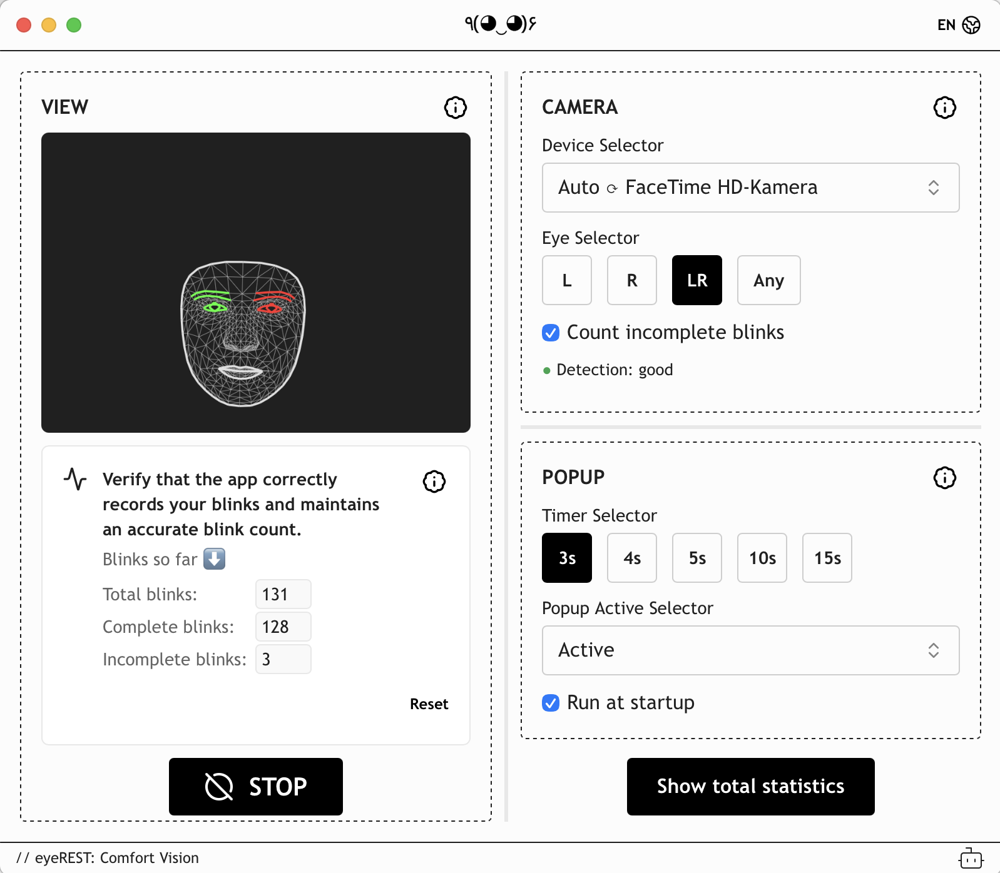
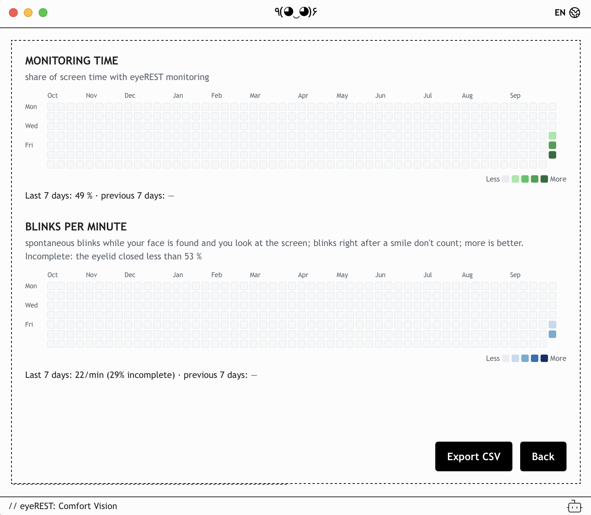
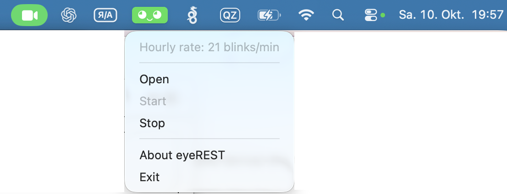

# eyeREST patch

**Make eyeREST a quiet, always-on blink coach that lives in your menu bar.**

**eyeREST** (Mac App Store) watches your eyes through the camera and shows a friendly smile when you forget to blink. This patch turns it into an app that just runs: it starts with your Mac, picks the right camera by itself, works over full-screen apps, and shows you how your blinking actually develops over days and weeks.

| Main window | Statistics | Menu |
|---|---|---|
|  |  |  |

> Unofficial. Not affiliated with or endorsed by the makers of eyeREST. This repository contains only the patch; you need your own copy of eyeREST from the Mac App Store.

## Why you'll like it

### 👀 Set it and forget it
- **Starts with your Mac** and begins monitoring right away, out of sight in the menu bar. No Dock icon, no window in your way.
- **Always the right camera.** Plug in an external camera or a monitor with a built-in one, and eyeREST switches over. Unplug it, and it goes back to the laptop camera. Even with the window closed.
- **Works everywhere.** The smile also appears over full-screen apps such as your editor or browser, centered on the screen you're using.

### 😊 Smarter reminders
- **Accurate blink detection.** Blinks are measured from the shape of your eyelids, so the smile shows up when you really forgot to blink, not because the camera got confused.
- **Complete vs. incomplete blinks.** Half blinks don't wet your eyes properly and are a common cause of dry eyes at the screen. Choose whether they count, and train yourself to blink fully.
- **Handles awkward camera angles.** Laptop camera above the screen, external camera off to the side: eyeREST adapts. Choose **Any** eye if one eye is hard to see, and get a gentle hint when the camera angle is really bad.
- **Knows when you look away.** Writing on paper or reading notes doesn't count against you.
- **Tells you when you're out of view.** The smile stays up while your face isn't detected, so you notice right away.
- **A 4-second timer**, in addition to 3, 5, 10 and 15 seconds.

### 📊 See your progress
- **Live counters** for total, complete and incomplete blinks, with the share of each.
- **Your current blink rate** right in the menu bar menu (blinks per minute over the last 10 minutes), updating live while the menu is open.
- **GitHub-style yearly charts:** how much of your screen time eyeREST was watching over you, and how often you blink, day by day, with 7-day trends.
- **CSV export** with hourly data, ready for your own analysis.

### 🌍 Feels native
- Everything follows the app's language: English, German, Italian, Spanish, Russian, Japanese and Chinese.
- Matches the app's look, from the info dialogs to the buttons.
- Asks before quitting, and never holds up logging out or shutting down.

## Install

```bash
git clone https://github.com/sergeyvilov/eyerest-patch.git && cd eyerest-patch
./patch.sh            # builds a patched copy of /Applications/eyeREST.app
./install.sh          # replaces /Applications/eyeREST.app (asks for your password)
```

After installing, macOS will probably ask for **camera access** again, because the app's signature changed. It may also ask once whether eyeREST may access its own data. Allow both. Then tick **Run at startup** at the bottom of the Popup section.

**You'll need** the Xcode Command Line Tools (`xcode-select --install`) and `python3`.

**After an App Store update** of eyeREST, run the same two commands again.

**To go back** to the original app, run `./install.sh restore`, or delete eyeREST and reinstall it from the App Store.

## Good to know

- **Your settings stay.** The patched app keeps using eyeREST's own data, so your settings carry over.
- **Your data stays on your Mac.** The patch stores its statistics locally, inside eyeREST's own data, and sends nothing anywhere.
- **Statistics start when you install the patch.** Earlier days show as "no data".
- **Blink counting is an estimate.** It's tuned on real counted blinks but not clinically validated, and very shallow eyelid movements aren't counted.

## Under the hood

Curious how it works, or want to change something? The [technical notes](TECHNICAL.md) cover every feature in detail, how the patch hooks into the app, how blinks and gaze are measured, and how to debug it.
